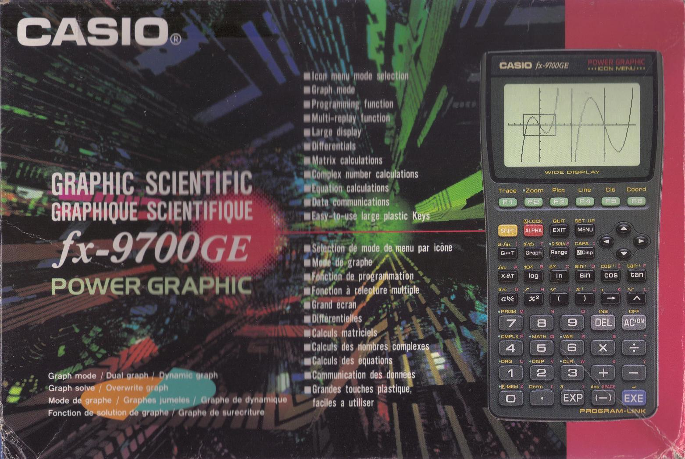

The Casio fx-180P is a vintage keystroke-programmable scientific calculator produced by Casio in Japan during the 1980s.

Its top feature for me was:

- Memory & Programming: 38 merged program steps across two program areas (P1 and P2), conditional/unconditional jumps, 7 arithmetic memory registers, 6 constant/data registers (and Simpson's rule numerical integration)

http://www.arithmomuseum.com/album.php?cat=c&id=372&lang=en

https://www.manualslib.com/manual/3778126/Casio-Fx-180p.html

I made couple of tiny programs for it 35 years ago.
Now let's try to find them in the garage 🤓

Also, got the FX-9700ge, which got no emulator at all ..
(note there's a free online emulator to another model 9750GIII inside https://ClassPad.net)

